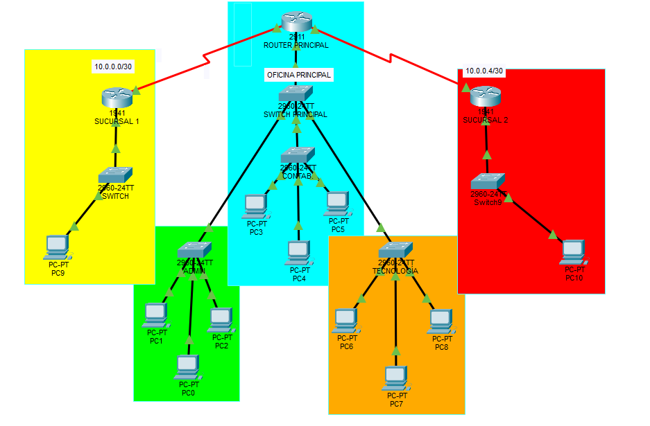

# Infraestructura de Red Empresarial | Cisco Packet Tracer

Proyecto académico de diseño y simulación de una infraestructura de red para una empresa con **una oficina principal y dos sucursales**, desarrollado en **Cisco Packet Tracer**.

## Vista de la topología



## Arquitectura

La topología se organiza en tres ubicaciones:

| Ubicación | Infraestructura visible |
| --- | --- |
| Oficina principal | 1 router, 1 switch principal, 3 switches departamentales y 9 computadoras |
| Sucursal 1 | 1 router, 1 switch y 1 computadora |
| Sucursal 2 | 1 router, 1 switch y 1 computadora |
| **Total** | **3 routers, 6 switches y 11 computadoras** |

En la **oficina principal**, la red se distribuye en tres departamentos:

- **Administración:** 3 computadoras.
- **Contabilidad:** 3 computadoras.
- **Tecnología:** 3 computadoras.

Cada departamento se conecta a su propio switch de acceso, enlazado al switch principal de la oficina.

## Enlaces entre sedes

En el diagrama se identifican dos subredes para los enlaces entre routers:

| Enlace | Subred indicada en el diagrama |
| --- | --- |
| Oficina principal ↔ Sucursal 1 | `10.0.0.0/30` |
| Oficina principal ↔ Sucursal 2 | `10.0.0.4/30` |

> Estas subredes corresponden a las etiquetas visibles en la topología. Para consultar la configuración exacta de interfaces, direcciones LAN y enrutamiento, abre el archivo `.pkt` en Cisco Packet Tracer.

## Tecnologías y conceptos aplicados

- Cisco Packet Tracer
- Redes LAN y enlaces entre sedes
- Routers y switches Cisco
- Direccionamiento IPv4 y subredes `/30`
- Segmentación física de la red por departamentos
- Diseño de topologías empresariales

## Archivos del repositorio

```text
Infraestructura-Red-Empresarial/
├── capturas/
│   └── topologia.png
├── topologia/
│   └── Infraestructura-Red-Empresarial.pkt
└── README.md
```

## Cómo abrir el proyecto

1. Instala **Cisco Packet Tracer**.
2. Descarga o clona este repositorio.
3. Abre `topologia/Infraestructura-Red-Empresarial.pkt`.
4. Explora las conexiones y revisa la configuración de cada dispositivo.
5. Utiliza las herramientas de simulación de Packet Tracer para verificar la conectividad.

## Alcance

Este repositorio presenta el diseño y el archivo de simulación del proyecto académico. La captura permite comprobar la distribución de equipos y los enlaces representados; no constituye por sí sola evidencia de pruebas exitosas de conectividad o de la configuración interna de todos los dispositivos.

## Autor

**Brayan**  
Portafolio: [GitHub](https://github.com/Brayande21)
